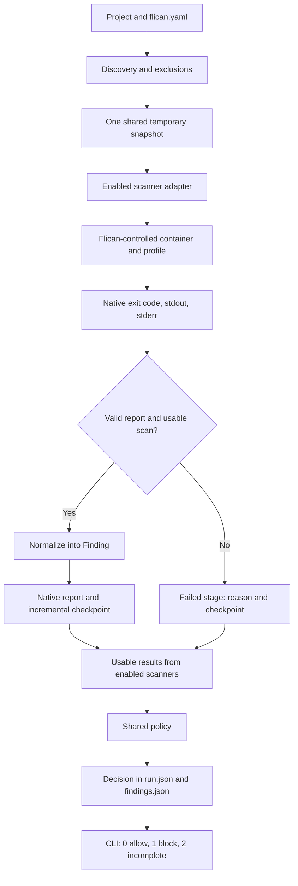

# Adding a scanner to Flican

Reference procedure for extending the existing Gitleaks, Semgrep, Trivy, and
Checkov integrations. Checkov provides a [worked contract](CHECKOV.md) for local
Terraform and Dockerfile scanning.

The aim is to reuse the same execution flow for every tool. Report formats,
exit codes, rules, and cache requirements must be verified for each scanner.

## 1. Common execution flow



Each run prepares **one shared snapshot** for the enabled scanners. An adapter
receives its path; it does not copy the project again. Reports remain under
`<project>/.flican/runs/<run-id>/reports/` after the snapshot is removed.
The scanner detects issues and produces a report. The adapter validates and
translates that report. Flican's policy makes the final decision.

## 2. Files involved

Paths are relative to the repository root:

| File | Expected work |
| --- | --- |
| `src/flican/adapters/<scanner>.py` | Pinned image, arguments, execution, parsing, normalization |
| `src/flican/core/docker.py` | Reuse `get_container_user()` and `remove_container()` |
| `src/flican/core/paths.py` | Reuse `normalize_source_path()` after adapting native paths |
| `src/flican/core/models.py` | Extend `Finding` only when structured data is missing |
| `src/flican/core/config.py` | Add the identifier to accepted scanners |
| `src/flican/core/provenance.py` | Register image, resources, ignore files, and attested profile |
| `src/flican/cli/main.py` | Execute the adapter, aggregate findings, display counts |
| `src/flican/rules/<scanner>/` | Add controlled configuration/rules when required |
| `pyproject.toml` | Include new resources in the wheel when required |
| `tests/test_<scanner>.py` | Verify native contract, normalization, cleanup |
| `tests/test_config.py`, `tests/test_cli.py` | Verify activation, errors, gate, reports |
| `tests/fixtures/` | Add synthetic cases; trial project is under `projects/calculator/` |
| `README.md`, `tests/fixtures/projects/calculator/README.md` | Document version, validated coverage, commands |
| `src/flican/reporting/dojo_export.py`, `dojo_sync.py` | Add Generic mapping and synchronization selection |
| `src/flican/platform/bootstrap.py`, `compose.yaml` | Create Test Type and configure deduplication identities |

Scanner selection currently uses a validated configuration list and explicit
runner/parser/normalizer tables in `main.py`. There is no auto-discovered plugin system.

Since DefectDojo integration, completed runs also have a manifest and private
attestation. Update `IMAGES`, `IGNORE_FILES`, and resource hashing in
`provenance.py` as needed. Coverage must be explicitly attested before missing
findings may be closed; closure is denied by default. Test Type names must match
exactly across export, bootstrap, and deduplication settings.

## 3. Integration procedure

### Step 1 — Define the contract before coding

Record the scanner category, target formats, and first-iteration coverage.
Separate advertised tool capabilities from capabilities actually validated in Flican.
Check official documentation and source for:

- image, version, platform, digest, `ENTRYPOINT`, and `CMD`;
- machine-readable output, offline mode, telemetry disablement;
- native exit codes for clean scans, findings, and failures;
- errors/warnings that can indicate incomplete scans;
- implicitly loaded configuration, exclusions, and suppressions;
- required caches, databases, rules, licenses, or API keys.

**Deliverable:** a short contract defining scope and distinguishing completion,
findings, and operational failures.

### Step 2 — Exercise the engine on tiny examples

Pull the selected version, record its digest, and check `--version`. Keep an
`image:version@sha256:…` reference in the adapter. Prepare a fixture with one
targeted issue and a corrected variant. Inspect JSON, stderr, and native exit
codes for both; correcting the target check may leave other findings.

For structured formats, add invalid input to identify parsing errors. Also test
what happens when no compatible files are found. Use synthetic data; IaC tests
scan files and do not need to provision infrastructure.

**Deliverable:** reproducible examples that inform the parser.

### Step 3 — Build the execution adapter

| Typical function | Responsibility |
| --- | --- |
| `build_scan_arguments()` | Construct native arguments |
| `build_docker_command()` | Validate paths and construct the Docker command |
| `run_<scanner>()` | Execute with timeout and remove the container in `finally` |
| `parse_<scanner>_report()` | Validate the native result and extract useful data |
| `normalize_<scanner>_finding()` | Produce the common `Finding` model |

Reuse the prototype controls: pinned image, `--pull=never`, source mounted read-only
at `/src`, `--network=none`, `--read-only`, `--cap-drop=ALL`, `no-new-privileges`,
and a user determined by the Docker helper. Provide required temporary locations.

Flican controls the profile and rules. Verify that project configuration cannot
implicitly load Python checks, alter exclusions, or force success. Static scans
must not execute application installation scripts or tests.

If a database is needed, separate network preparation from offline scanning,
as with Trivy. Keep the path configurable, define freshness rules, and coordinate
updates when operations share a cache. Keep caches outside snapshots through
location or exclusions. The [Trivy database contract](TRIVY_DATABASE.md) covers
automatic preparation, offline mode, digest pinning, locking throughout scans,
and recorded metadata. Network preparation remains separate from the source
worker even when one command orchestrates both.

**Deliverable:** isolated execution and verified cleanup, including timeout cases.

### Step 4 — Validate the native report

Validate native exit code, JSON structure, required fields, reported errors,
and consistency with the controlled profile. Invalid JSON, parsing errors,
and crashes must never become empty finding lists. An empty list alone does
not prove compatible files were scanned; inspect available coverage counts.

Stderr may contain ordinary logs. Handle diagnostics according to the verified
scanner contract. Any tolerance must target a precise documented and tested
case, rather than ignoring all warnings. Trivy's Python-license warning outside
the `vuln` scope is one known example. Preserve grouping context such as file,
package, or resource; the Trivy parser retains each vulnerability's `Target`.

**Deliverable:** a usable result or an explicit operational error.

### Step 5 — Normalize without losing meaning

Populate `scanner`, `rule_id`, `description`, `severity`, `file_path`, and `line`.
Normalized paths are project-relative; reject paths outside the snapshot and
`..` traversal. Verify native path conventions before transforming them.
A line is a positive integer or `None`; do not invent missing locations.

Use `package_name`, `package_version`, and `fixed_version` for dependencies.
Preserve Terraform resources in structured resource fields rather than package fields.
Define the severity mapping explicitly. If the engine does not supply severity,
document Flican's fallback and its source. Unknown values must not silently
become `low` or `info`.

When extending `Finding`, prefer optional fields with compatible defaults.
Assess JSON-reader and schema-version impact; retain native details in raw reports.

**Deliverable:** comparable findings with preserved context for the shared policy.

### Step 6 — Connect configuration and CLI

The new scanner is initially **optional**. Retain existing defaults unless a
behavior change is intentional and documented. In `scan()`, check prerequisites,
execute within the existing `temporary_snapshot()`, save native JSON, and add
normalized findings to the list used by `should_fail()`. Display its count or
disabled state. Enable configuration acceptance only when execution is ready.
Every enabled accepted scanner must actually run; a disabled scanner must not
require its resources.

The engine creates a stage, saves its validated report, and updates `run.json`
and `findings.json`. Later independent scanners continue after a failure;
the final run then becomes incomplete with code `2`. See [RUN_EXECUTION.md](RUN_EXECUTION.md).
Do not directly translate a native exit code into Flican's verdict:

| `flican scan` code | Meaning |
| --- | --- |
| `0` | Scan completed and gate passed, including findings below threshold |
| `1` | Scan completed and policy blocked the result |
| `2` | Configuration, execution, or report-processing error |

`StageResult.coverage` retains available coverage. Checkov currently exposes
it in detail. Extending other engines requires a verified native contract;
skipped checks must not be presented as passing checks.

### Step 7 — Verify useful behavior

| Level | Essential cases |
| --- | --- |
| Parser | Valid empty report, findings, crash, invalid JSON, partial errors, exit mismatch |
| Normalization | Preserved data, escaping paths, invalid positions, missing/unknown severity |
| Execution | Timeout, cleanup, expected snapshot/cache/config access |
| Configuration | Scanner alone, combinations, unknown value, duplicate, unchanged defaults |
| CLI | Disabled scanner not called, missing prerequisite, code `2`, preserved reports/metadata |
| Gate | Same finding retained below threshold with `0`, then blocked at threshold with `1` |
| Real engine | Vulnerable/corrected fixtures, then combinations with existing scanners |

Use mocks for failures and timeouts, and real containers to confirm the native
contract. Assert behavior, coverage, and useful data rather than reproducing the implementation.

### Step 8 — Verify distribution and document

Include required bundled rules/configuration in package data and verify their
presence and use from an installed wheel. Resource paths must not depend on the
working directory. Adapt these checks to the change:

```bash
python -m unittest discover -s tests -p 'test_<scanner>.py' -v
python -m unittest discover -s tests -p 'test_config.py' -v
python -m unittest discover -s tests -p 'test_cli.py' -v
```

Shared core changes also require relevant adapter regression tests. If package
resources changed:

```bash
python -m pip wheel . --no-deps --wheel-dir dist
```

Update READMEs with version/digest, validated formats, active rules, requirements,
limits, commands, and observed results. Mark only completed roadmap tasks as done.

## 4. Checkov execution plan — completed for Terraform and Dockerfile

**Completed iterations: local Terraform, then Dockerfile.** Kubernetes still
needs its own fixtures and integration. Checkov scans files; live account audits
and infrastructure provisioning are separate workflows. These steps illustrate
the procedure as applied:

1. **Characterize the image.** [Checkov 3.3.30](https://github.com/bridgecrewio/checkov/releases/tag/3.3.30)
   is the validated version. Actual digest, entrypoint, and version were verified;
   the image is pinned in the [adapter](../src/flican/adapters/checkov.py).
2. **Prepare fixtures.** Use a tiny `.tf` with one targeted issue and a corrected
   variant. Record JSON and counters before implementing the parser.
3. **Fix the profile.** Restrict frameworks to Terraform/Dockerfile, request JSON,
   run without network, use `--skip-download`, disable external module downloads,
   and verify suppressions and parsing errors in real output.
4. **Control configuration.** Checkov searches multiple locations including the
   scanned project; see its [configuration behavior](https://github.com/bridgecrewio/checkov#configuration-using-a-config-file).
   Enforce a Flican-controlled profile. Test that a project `.checkov.yaml` cannot
   change the contract, and that a missing explicit profile fails. Bundle the profile.
5. **Resolve severity before gate integration.** [`--skip-download` omits severity metadata](https://www.checkov.io/2.Basics/CLI%20Command%20Reference.html).
   Findings without native severity use HIGH with `severity_source: flican_policy`.
   Recognized native severity is retained with Checkov attribution. This is a
   Flican blocking policy, not a Checkov CVSS rating.
6. **Create the adapter.** Reuse helpers, validate JSON, preserve IaC resource identity,
   and add optional model fields without repurposing dependency fields.
7. **Integrate CLI.** Add optional `checkov`, `IaC findings`, `checkov.json`, and
   normalized findings in the common gate.
8. **Validate and record status.** Test errors, project config, suppressions,
   timeout, normalization, and gate. Try the engine alone and with all three
   existing scanners. Verify installed assets and document actual coverage.

Dockerfile integration needed two further checks:

- **Multiple frameworks:** native JSON is one object for a single framework and a
  list for several. Validate every report, reject duplicates/unexpected frameworks,
  and check the exit code against the total failure count.
- **Silently skipped files:** this version may ignore an invalid/unreadable Dockerfile
  without a parsing error and return `0`. Compare selected Dockerfiles with paths
  in passed, failed, or suppressed checks. A missing expected file gives code `2`.

Aggregate counts remain available, with per-framework coverage in
`coverage.checkov.frameworks`. A framework missing from JSON is `not_reported`
with unknown counters. Each normalized Checkov finding includes `framework`.
See the contract for native summaries without framework identity.
Native codes depend on hard/soft-fail options, as [documented by Checkov](https://www.checkov.io/2.Basics/Hard%20and%20soft%20fail.html).
Flican fixes those options and validates report consistency; `should_fail()` makes the final decision.

## 5. Completion criteria

Copy this checklist for each future scanner. Checkov validation is recorded in
[its contract](CHECKOV.md) and test suites.

- [ ] Image pinned by digest and version verified.
- [ ] Initial coverage and controlled configuration documented.
- [ ] Fixtures and native contract checked on the real engine.
- [ ] Parser/normalization distinguish findings, errors, and insufficient coverage.
- [ ] Scanner-specific data and severity origins preserved.
- [ ] Optional activation, requirements, reports, and gate tested.
- [ ] Cleanup verified after timeout or failure.
- [ ] Required resources usable from the installed package.
- [ ] README and roadmap match completed validation.
