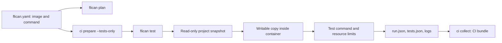

# Application tests with Flican

`flican test` runs a declared command in a container and produces artifacts
collectable through the same CI interface as scans. Build and image/SBOM checks
are documented in [IMAGE_WORKFLOW.md](IMAGE_WORKFLOW.md).

## Choose who runs application tests

Developers can keep Python/npm tests in Jenkins or GitHub Actions and use Flican
only for security checks. They can also delegate a declared test command to
Flican. A `tests` configuration block does not execute code during `scan`, `plan`,
or `project init`; `test` is explicit.



## Accepted configuration

The block is optional. `project init` still creates only the starter configuration.
Add this to a project that already has tests:

```yaml
tests:
  image: python:3.12-slim-bookworm@sha256:e697c81897302a4c4333bade000d98038fbb21eb064f8ee1fd42d02ebcd9d337
  command: [python, -m, unittest, discover, -s, tests, -v]
  timeout_seconds: 60
  network: none
```

The image must include a SHA-256 digest, command must be a nonempty argument list,
and timeout must be an integer between 1 and 1800 seconds. Defaults are 300 seconds
and `network: none`. Unknown keys are rejected.

A Node command can use the same interface:

```yaml
tests:
  image: node:22-bookworm-slim@sha256:c3de60bf2f9dd0ac6370e6117950ff62d6e339527e7472301c9c78a017978392
  command: [node, --test, app.test.cjs]
  timeout_seconds: 60
  network: none
```

These are validated runtimes, not automatic framework detection. The image must
provide `/bin/sh`, `cp`, and requested executables. Dependencies can already be
installed in the image. To install them during testing, explicitly select
`network: bridge` and declare a command such as `[sh, -c, "npm ci && npm test"]`.
That shell runs inside the container; Flican does not concatenate the command
into a host shell.

Configuration does not accept host networking, privileged mode, or Docker socket
mounts. Host environment/authentication files outside the project are not passed
to the worker. Non-excluded project files are copied into the snapshot.

## Local commands

The calculator fixture has three `calculate` tests: addition, negative values,
and invalid expressions.

```bash
flican plan tests/fixtures/projects/calculator
flican ci prepare tests/fixtures/projects/calculator --tests-only
flican test tests/fixtures/projects/calculator
```

`--tests-only` prepares only the declared test image, without scanners or Trivy
database. Without it, `ci prepare` retains scanner preparation. `test` uses
`--pull=never`: missing images cause explicit errors rather than downloads.
`plan` shows command, image digest, network, and timeout without running them.
`project.exclude` also applies to tests; `.flican` is always excluded.

## Isolation and results

The runner mounts a read-only snapshot at `/src` and copies it into container
workspace `/work`. Tests can create caches, modify fixtures, or write files
without changing the original project. Test snapshots preserve executable script bits.

The fixed profile uses 1 CPU, 512 MiB memory, 128 processes, a 256 MiB temporary
workspace, and 64 MiB `/tmp`. The root filesystem is read-only; workspace execution
is allowed while `/tmp` remains `noexec`. Capabilities are dropped and new
privileges disabled. Tmpfs usage counts toward container memory, not extra RAM.
Network is `none` unless `bridge` is explicitly declared.

Combined stdout/stderr is retained in an 8 MiB bounded log. Exceeding log or time
limits is an operational error; the container is removed and written diagnostics
remain available. Limits are fixed in this increment. Projects requiring more
resources can retain their CI-owned test step.

| Program outcome | Interpretation | Flican exit |
| --- | --- | --- |
| 0 | Test command succeeded | 0 |
| 1 | Failed tests, usable outcome | 1 |
| Other exit | Command/runtime failure requiring investigation | 2 |
| Timeout, cancellation, oversized log | Incomplete execution | 2 |

The declared command determines the outcome. This generic runner does not parse
JUnit, count assertions, or guarantee that a framework collected tests. JUnit and
coverage files generated under `/work` are not yet exported; current artifacts
are JSON results and logs.

Each invocation creates:

```text
PROJECT/.flican/runs/RUN_ID/
  run.json
  reports/tests.json
  logs/tests.log
  manifest.json          # Only after native exit 0 or 1
```

The run uses `mode: test` and the shared `Run`/`StageResult` contract. Assertion
failure remains execution `completed` with decision `block`; operational failure
is `failed`/`incomplete`, timeout is `timed_out` at the stage, cancellation is
`cancelled`. Incomplete-run diagnostic logs appear in global artifacts without
claiming a usable stage result.

JSON records the image digest, command, profile, executable-aware snapshot hash,
native exit, and optional error. Complete artifacts are registered in private
local state. Test runs do not synchronize to DefectDojo as vulnerability reports.
Passing tests and passing security policy are separate decisions.

## CI usage

After checkout/install, from the workspace containing the project, choose a
fresh reference/bundle path for every build:

```bash
flican ci prepare tests/fixtures/projects/calculator --tests-only
flican_test_exit=0
flican test tests/fixtures/projects/calculator \
  --result-file .flican/ci/test-001/result.json || flican_test_exit=$?
flican ci collect .flican/ci/test-001/result.json \
  --exit-code "$flican_test_exit" --workspace "$PWD" \
  --output-dir .flican/ci/test-001/bundle
```

`ci collect` verifies command, mode, actual process code, and hashes. It preserves
`0`, `1`, or `2`, rejecting inconsistent references or modified logs. Bundles
contain `test-result.json`, `collection.json`, and artifacts under `run/`.
Incomplete runs collect diagnostics without attestation. `--scan-exit` is also
accepted as an alias for source templates.

Jenkins can archive with `post { always { archiveArtifacts ... } }`; GitHub Actions
can upload with `if: always()`. Upload remains a CI-provider step. Existing source
templates still run only scanners; adding this command does not itself prove
new remote test execution.

## Verification

```bash
python -m unittest discover -s tests -v
FLICAN_APPLICATION_DOCKER_TESTS=1 \
python -m unittest discover -s tests -p test_application_docker.py -v
```

Docker tests cover Python/Node pass/fail, read-only source and writable copies,
absence of credentials/socket, timeout/cleanup, missing commands, bounded logs,
executable scripts, and explicit network selection. Pinned images must be local.

References: [Docker run and limits](https://docs.docker.com/engine/containers/run/),
[Docker tmpfs](https://docs.docker.com/engine/storage/tmpfs/),
[Python unittest](https://docs.python.org/3.12/library/unittest.html),
[Node 22 test runner](https://nodejs.org/docs/latest-v22.x/api/test.html).
