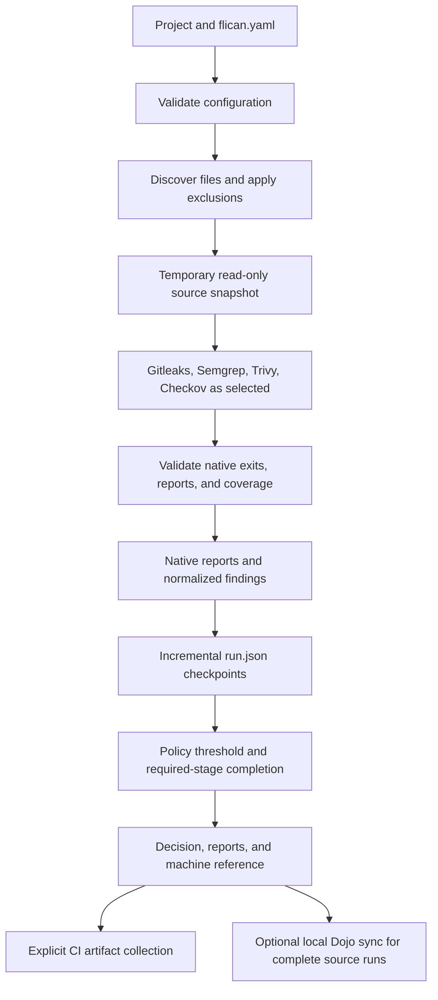

# Flican architecture

Flican is a Python CLI and local execution engine for security checks. Developers
can run it directly or call it from an existing CI pipeline. It coordinates
scanner tools, validates their results, applies a common policy, and retains
verifiable artifacts. Optional commands also run application tests and build images.

## Components

Paths below are relative to `src/flican/`:

| Component | Responsibility |
| --- | --- |
| `cli/` | Typer commands, options, per-command orchestration, terminal output |
| `core/config.py`, `planning.py`, `discovery.py`, `snapshot.py` | Validate configuration, select files, preview execution, snapshot source |
| `adapters/` | Pinned scanner commands, native-report validation, normalization |
| `core/models.py`, `execution.py`, `policy.py` | Run/StageResult/Finding contracts, checkpoints, final decisions |
| `core/provenance.py`, `state.py`, `ci.py` | Local attestations, private state, CI preparation and collection |
| `core/testing.py`, `building.py`, `oci.py` | Application test runner, BuildKit export, OCI validation |
| `reporting/` | Generic findings export and explicit DefectDojo synchronization |
| `platform/` | Optional local DefectDojo Compose stack and bootstrap |
| `rules/` | Bundled Semgrep rules and Checkov profile |

The CLI calls Python modules in one orchestration process. Scanner/test workers
are temporary containers. DefectDojo is an optional persistent service with its
own API and browser interface; Flican has no separate application API server.

## Source scanning



Source scanners share one snapshot and run sequentially. Independent scanners
continue after a scanner failure; usable results are retained. A required failure
makes the final result incomplete, regardless of other successful stages.
The snapshot is removed at command exit, while reports stay under `.flican/`.
The `.flican` output directory is always excluded.

Native scanner exits are interpreted by adapters. They are distinct from the
common CLI decision:

| Exit | Decision | Meaning |
| --- | --- | --- |
| `0` | `allow` | Required execution completed and findings do not block policy |
| `1` | `block` | Usable findings or completed application tests block policy |
| `2` | `incomplete` | Configuration, execution, report, timeout, or integrity failure |

See [RUN_EXECUTION.md](RUN_EXECUTION.md), [SCAN_RESULT.md](SCAN_RESULT.md), and
the [scanner integration procedure](ADDING_A_SCANNER.md) for contracts.

## Application and image workflow

```text
source scan → optional application tests → build or existing OCI → image scan/SBOM
```

`scan` performs static source checks. `test`, `build`, `image scan`, and
`pipeline run` are separate explicit commands. A declared test/build block does
not execute application code during a source scan or plan preview.

CI can retain its own tests and builder, then call `scan` and `image scan`.
Alternatively, `pipeline run` orchestrates dependencies against frozen source,
retains verified child bundles, and skips dependents after a source/test block.

Build uses the existing Docker Engine's Buildx `docker` driver and containerd
image store. Image scanning verifies OCI archive, manifest, configuration, and
layer identities, checks CVEs/secrets/effective USER, and generates CycloneDX
through Trivy. SBOM properties bind the archive and manifest digests.
External OCI input has `source_to_image: unverified-external`; scanning does not
prove that a caller-built image came from the checked-out source.

See [APPLICATION_TESTS.md](APPLICATION_TESTS.md) and [IMAGE_WORKFLOW.md](IMAGE_WORKFLOW.md)
for resource profiles, input formats, configuration, and limits.

## Data and trust boundaries

```text
PROJECT/
  flican.yaml
  .flican/runs/RUN_ID/
    run.json
    reports/
    logs/                 # When produced by the command
    manifest.json         # For a complete attested execution
```

Private SQLite state and reporting credentials live outside the project, under
`$XDG_STATE_HOME/flican` or `~/.local/state/flican`, unless `FLICAN_STATE_DIR`
overrides the location. Trivy data is cached separately; see [TRIVY_DATABASE.md](TRIVY_DATABASE.md).

- Scanners use pinned images and offline workers without the Docker socket.
  Image/database preparation can use the network separately.
- Application tests and Dockerfile builds execute project code explicitly.
  BuildKit resource control follows the limits documented in the image guide;
  the current driver has no per-build CPU/RAM quota.
- Complete artifacts are hash-registered in private local state. A collected
  `verified_locally` bundle proves local verification, not portable signing or
  cross-runner producer authentication.
- Dojo synchronization is explicit and currently accepts complete standalone
  source runs. Tests/build/image/pipeline results are collectable but are not
  imported into Dojo. Credentials/private state are not CI artifacts.

## Roadmap

- Additional reusable application templates beyond the synthetic Jenkins/GitHub demo workflows.
- Finding triage context, scoped exceptions/VEX support, and clearer human summaries.
- Portable project/branch identity, remote Dojo onboarding, and inter-runner provenance.
- Additional language/rule coverage, Kubernetes checks, and SARIF/HTML exports.
- Optional AI providers for finding explanations and remediation suggestions.
- Explicitly scoped live cloud audits and DAST.
- Independent rootless build support and controlled publication of evaluated images.

These are extensions, not accepted configuration options or current commands.
The [product README](../README.md) and individual guides describe delivered behavior.
