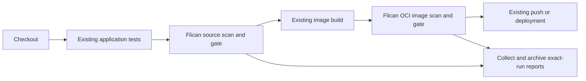

# Flican in an existing pipeline

Flican provides security steps that can be inserted into an existing CI
pipeline. DevOps retains checkout, application tests, builder, registry, and
deployment. Optional `test`, `build`, and `pipeline run` commands can also
orchestrate those local execution steps explicitly.

## Responsibilities

| Usage | CI responsibility | Flican responsibility |
| --- | --- | --- |
| Security steps | Existing checkout, tests, build, push, deployment | Selected source/image scans, policy, verifiable reports |
| Optional local workflow | Trigger, runner, artifact retention | Source checks, declared tests/build, image/SBOM, policy |

Both use the same adapters and result contracts. Existing CI stages are not
repeated implicitly. Flican does not currently publish or deploy images.

## What Flican adds

Direct scanner commands remain a valid choice. Flican reduces integration work
by keeping pinned tool profiles, validating different native exits/reports,
normalizing findings, applying one policy locally and in CI, and collecting
exact-run evidence. It does not improve the underlying engines' detection.
Optional local Dojo integration also manages stable import contexts and receipts.

## Integration workflow

1. Version `flican.yaml` in the application repository and select scanners/policy.
2. Install Flican from a verified wheel or this repository on a Linux runner.
3. Run `flican ci prepare PROJECT` to prepare pinned images and the Trivy database
   when selected. Preparation may use the network; scan workers remain offline.
4. Run source scanning with a fresh `--result-file` destination.
5. Collect artifacts before propagating the actual scan exit. Archive the bundle
   even when the policy blocks or a scanner fails.
6. Build/export OCI using the CI's builder, then call `flican image scan` with
   a separate fresh reference and collect its results.
7. Allow dependent release steps only when their required checks pass.

The [composite action](../action.yml) provides source scanning. The versioned
[CI examples](CI_TEMPLATES.md) also demonstrate application tests, OCI build,
and image scan/SBOM on the synthetic calculator project. Adapt their project
preparation, test command, and Dockerfile to an existing application.
The [image guide](IMAGE_WORKFLOW.md) describes accepted artifacts and local orchestration.
There is no public package/Marketplace release or dedicated Jenkins plugin yet.

An existing image can be passed through `image scan --input` or
`pipeline run --image-input` without rebuilding. Only supported local OCI
archives are accepted. External-image reports explicitly state that source
linkage is unverified; the caller remains responsible for publishing/deploying
exactly the evaluated artifact.

## Gate and artifact handling

| Exit | Meaning | Pipeline handling |
| --- | --- | --- |
| `0` | Required execution complete; policy passed | Dependent steps may proceed |
| `1` | Complete result blocked by policy or tests | Retain artifacts; block dependents |
| `2` | Incomplete or operational/integrity error | Retain available diagnostics; block dependents |

Use [machine references](SCAN_RESULT.md), not terminal parsing or the newest
run directory. References and collection destinations must be fresh per build
and attempt. Preserve the real process code and use `ci collect` to validate
reference consistency and artifact hashes. Do not turn failures into success
with `|| true`.

GitHub Actions should upload the exact bundle with `if: always()` and
`include-hidden-files: true`, because `.flican` is hidden. Jenkins should archive
that bundle in `post { always { ... } }`. Keep private state and credentials
outside uploads. See [CI_TEMPLATES.md](CI_TEMPLATES.md) for the shared commands.

Scan and collection share the same local `FLICAN_STATE_DIR`. A
`verified_locally` bundle verifies data against that runner's private state;
it does not provide portable signatures or cross-job producer authentication.
Cross-runner identity and provenance require further design.

## Existing tests and SonarQube

Keep existing npm/Python tests and SonarQube quality gates if they already meet
team requirements. Select Flican scanners to avoid redundant work without
claiming absent coverage. Both independent gates can be required by team policy.
The [official SonarQube/Jenkins integration](https://docs.sonarsource.com/sonarqube-server/analyzing-source-code/ci-integration/jenkins-integration/key-features)
handles its own analysis and gate response.

A SonarQube adapter or import of arbitrary external scanner reports is not a
current Flican capability. External JSON would need verified execution,
identity, profile, and coverage before it could be trusted or close findings.

## DefectDojo in CI

Dojo is optional. The default workflow ends with gates and artifacts, without
starting a reporting stack, requiring a Dojo token, or synchronizing automatically.
Local complete source runs can be synchronized explicitly; see [DEFECTDOJO.md](DEFECTDOJO.md).

The current integration uses private local state and absolute project paths.
Remote-instance onboarding, a proposed `--dojo-url`, portable CI artifact import,
and cross-runner synchronization are not implemented. These extensions are
independent of source/image scanning.

A persistent reporting destination must be reachable from the synchronization
process. Loopback on a hosted runner refers to that runner, not a developer's
computer. `0.0.0.0` is a bind address, not a client destination URL.
Credentials belong in private state or a scoped CI secret manager, not project
YAML or uploaded reports. Existing context IDs must stay bound to their instance.

See the [architecture roadmap](ARCHITECTURE.md#roadmap) for remaining capabilities.
