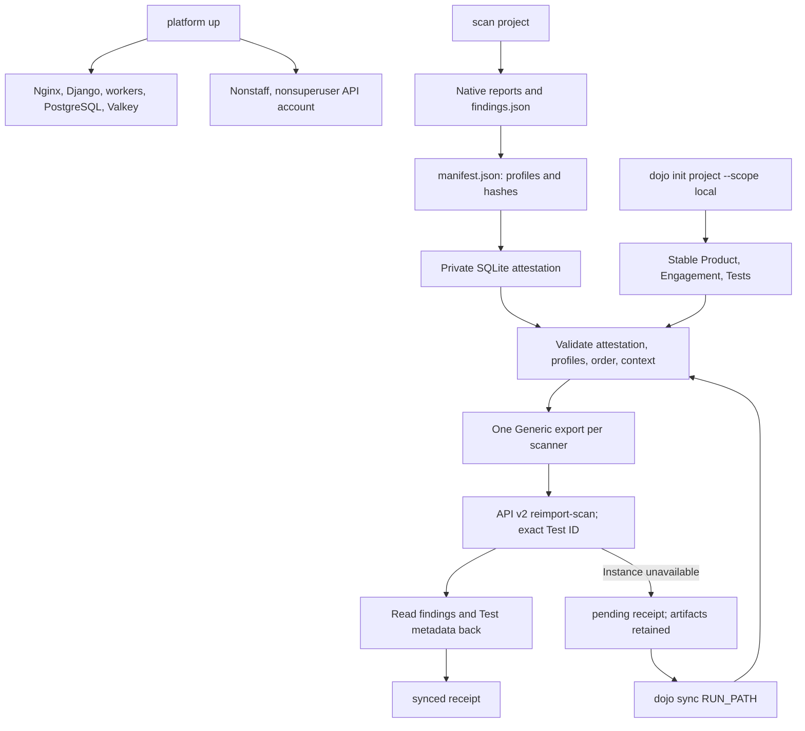

# Local DefectDojo and Flican synchronization

Optional local reporting with stable scanner contexts, verified reimport,
triage preservation, and retry receipts.

## Optional integration

Scans, gates, and artifacts work without Dojo, locally
and in CI. Default CI retains reports without starting Dojo or requiring tokens.
Sending results is explicit. The current prototype provides a local stack plus
`dojo init`/`dojo sync`. External-instance onboarding, a proposed `--dojo-url`,
and local import of downloaded CI artifacts are not delivered. They remain
independent of build/image scanning; see [the CI design](CI_INTEGRATION.md#defectdojo-in-ci).

## Available functionality

- DefectDojo **3.4.304** at `http://127.0.0.1:8088`.
- One Product per local project path, one Engagement per stable scope, one Test
  per scanner and compatible profile.
- **Generic Findings Import** exports for Gitleaks, Semgrep, Trivy, and Checkov,
  each with its own Test Type.
- Reimport into recorded Test IDs, with post-import finding verification.
- Local `pending`/`synced` receipts and retries without a new Test per run.
- Rejection of older runs, incompatible profiles, ambiguous contexts, tampered artifacts.
- Complete policy-blocking scans remain synchronizable.

## Workflow



`scan` is independent of Dojo availability. Sync follows explicitly. Scan exit
`1` indicates a policy block and does not prevent valid report import.

## Commands

From the repository with its venv active:

```bash
flican platform up
flican dojo init tests/fixtures/projects/calculator
flican ci prepare tests/fixtures/projects/calculator
flican scan tests/fixtures/projects/calculator
```

Project identity is based on the resolved absolute path. Moving a checkout
requires a new context and fresh scan; rewriting an old manifest does not
register a moved run. Keep the same private state for related commands.

Replace `RUN_ID` with the scan output:

```bash
flican dojo sync tests/fixtures/projects/calculator/.flican/runs/RUN_ID
```

Replaying the same run returns `already_synced`. A new compatible completed scan
reuses the Test. Profile, context, and finding identities are checked before writes.
For a separate stable branch scope:

```bash
flican dojo init tests/fixtures/projects/calculator --scope feature/example
flican dojo sync tests/fixtures/projects/calculator/.flican/runs/RUN_ID --scope feature/example
```

Choose scope explicitly and keep it stable across comparable runs. New scopes
create another Engagement in the same Product. Stop/restart while preserving data:

```bash
flican platform stop
flican platform up
```

A completed `initializer` after migrations is normal. Six persistent services
stay `running`, with PostgreSQL/Valkey `healthy`. Choose a different port with
`--port` on the first start and reuse it later; changing an existing version/port
requires planned migration.

## Access and private state

Web login: **`flican-admin`**. The generated password is stored in the private
`defectdojo/login.json` file. API account **`flican-sync`**
has no usable password, no staff/superuser flag, and belongs to Product Type
`Flican Managed Projects`.

Default state layout:

```text
${XDG_STATE_HOME:-~/.local/state}/flican/
  state.sqlite3                  # Attested runs, contexts, streams, receipts
  reporting.lock                 # Serialized local synchronization
  defectdojo/
    platform.json                # Installation version/port
    compose.env                  # Bootstrap secrets
    login.json                   # Web login
    connection.json              # URL, service token, type identifiers
    compose.log                  # Private Compose diagnostics
    bootstrap-error.log          # Redacted bootstrap failure diagnostics
```

`FLICAN_STATE_DIR` overrides this directory. All commands for one installation
must share state. Directories are `0700`, sensitive files `0600`. Credentials
are neither in `flican.yaml` nor passed to scanner containers.
Back up state and Docker volumes together: PostgreSQL retains triage; local state
retains mappings/attestations. `stop` preserves volumes.

Only Nginx publishes a loopback port. Application services, PostgreSQL, and Valkey
use an internal network; Nginx also has a web bridge. No service receives the
host Docker socket.

## Identities and triage

Products bind to the **resolved local project path**. Another checkout location
creates another Product; portable Git/CI identity is future work. Exact IDs are
stored locally. Incompatible existing identities or ambiguous matches are rejected.

Test Types are `Flican Gitleaks (Generic Findings Import)`,
`Flican Semgrep (Generic Findings Import)`, `Flican Trivy (Generic Findings Import)`,
and `Flican Checkov (Generic Findings Import)`. They explicitly use
`unique_id_from_tool` for deduplication/hash identity.

Version-1 fingerprints include context, profile, scanner, rule, path, and useful
coordinates. They exclude run ID, date, description, and severity.

- Terraform resource identity survives line shifts.
- Code/secrets use line/column to distinguish occurrences, including one line.
- Dockerfile lines distinguish repeated instructions.
- Dependencies include package and declared version.

Code moves/package-version changes can create new identities. Semantic move
matching is not promised. Indistinguishable occurrences cause export rejection.

Dojo owns triage. Flican does not force existing findings' API `active` or
`verified` flags. A real test verifies that a False Positive stays inactive after
rescan. Test metadata records run, local gate, profile, and coverage without
replacing triage notes.

## Integrity, receipts, outages

Completed scans write `manifest.json`, scanner profiles, and report hashes.
The private SQLite outside the project registers the attestation. Since
1 November, [Run/StageResult](RUN_EXECUTION.md) also checkpoints usable results
per stage. Complete scans attest `run.json`; failed runs remain locally readable
but unsynchronizable. Older registered runs without a journal remain supported
within their original registered state.

Before import, Flican checks the registration and every artifact. Rewriting both
project reports and manifest cannot replace private attestation. Unattested old
runs must be recreated. This relies on the local account/state; it cannot defend
against an administrator controlling that state.

Run-relative reporting files:

```text
manifest.json
reports/
  findings.json
  ... native reports ...
reporting/
  generic-CONTEXT-SCANNER-MODE.json       # Exported JSON payload
  defectdojo-CONTEXT-SCANNER-MODE.json    # pending/synced receipt
```

`payload_sha256` hashes canonical JSON independently of indentation. The request
is journaled before sending. After import, finding identities and run metadata
are reread from the targeted Test. Failure leaves `pending`; retries reuse the
same Test. Tests cover a lost response after commit. Verified receipts return
`already_synced` without another import.

Ordering is per scanner by run start time, with a watermark saved before the
remote request. An old run cannot replace a newer one, including after a lost
response. The local lock prevents competing local syncs.
The client uses API v2, timeouts, bounded sizes, TLS for remote origins, and HTTP
only on loopback. It follows neither authenticated redirects nor cross-origin
pagination. Tokens are not logged.

## Closing absent findings

The default explicitly sends **`close_old_findings=false`**. Partial reports do
not close findings missing from their output.
To close absent Checkov findings after a complete compatible scan:

```bash
flican dojo sync tests/fixtures/projects/calculator/.flican/runs/RUN_ID --scanner checkov --close-old
```

Closure requires Checkov `completed` coverage without suppressions. It is refused
for `partial`, `no_resources`, or scanners without detailed coverage contracts.
Gitleaks/Semgrep/Trivy support import/reimport with automatic closure disabled.
Their coverage/suppression contracts must improve before extending this option.
Real tests verified closure after correction, reactivation of the same finding
IDs after reappearance, and preservation of explicit triage.

## Versions and files

Images are pinned in the bundled Compose:

- Django 3.4.304: `sha256:6c767c6faab7bdf5df56fffe7ff8f140174c8104130c52a6ae63d74b11eefc8e`.
- Nginx 3.4.304: `sha256:7d7f663b2f0d209fd7abdd6b595fe981d96d46b6f15feceae4020fb826b350c5`.
- PostgreSQL 18.6-alpine and Valkey 9.1.2-alpine use release Compose digests;
  databases/media have persistent volumes.

| File | Responsibility |
| --- | --- |
| `platform/compose.yaml` | Services, images, volumes, networks, memory limits |
| `platform/manager.py` | Secrets, startup, readiness, stop/status |
| `platform/bootstrap.py` | API account and Flican types, executed inside Django |
| `core/state.py` | Private state and transactional SQLite |
| `core/provenance.py` | Profiles, manifest, artifact verification |
| `reporting/dojo_client.py` | API v2 HTTP/multipart transport |
| `reporting/dojo_export.py` | Generic mapping, fingerprints, validation |
| `reporting/dojo_sync.py` | Stable contexts, safeguards, reimport, receipts |
| `cli/platform.py`, `cli/dojo.py` | User commands |

Paths are relative to `src/flican/`.

## Reproducible validation

```bash
python -m unittest discover -s tests -v
FLICAN_DOJO_LIVE_TESTS=1 python -m unittest discover -s tests -p 'test_dojo_integration.py' -v
```

Live tests require the local Flican platform and Gitleaks/Semgrep/Checkov images.
They isolate state, create synthetic Products, and remove them after identity
checks without changing the calculator Product. Tests also check synthetic-secret
redaction and distinct same-line findings via native columns.

## References

- [Official 3.4.304 release](https://github.com/DefectDojo/django-DefectDojo/releases/tag/3.4.304).
- [Generic Findings Import](https://docs.defectdojo.com/supported_tools/parsers/generic_findings_import/).
- [Reimport behavior](https://docs.defectdojo.com/import_data/import_intro/reimport/).
