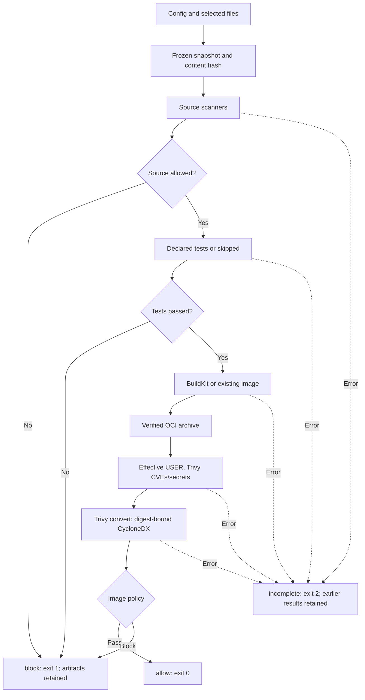

# OCI build, image scanning, and local workflow

Flican can build an OCI artifact, scan an existing image, or orchestrate the
source/tests/build/image sequence locally. CI can also retain its own tests and
builder and call the security commands separately. The versioned Jenkins and
GitHub Actions examples demonstrate the full sequence on a synthetic project;
the composite action itself provides source scanning and collection.

## Command responsibilities

| Command | Work | Main report |
| --- | --- | --- |
| `flican scan PROJECT` | Selected source secrets, SAST, SCA/IaC | `reports/findings.json` |
| `flican test PROJECT` | Declared test command in its container | `reports/tests.json` |
| `flican build PROJECT` | Declared Dockerfile → local OCI artifact | `reports/build.json` |
| `flican image scan PROJECT --input candidate.oci.tar` | Image CVEs, secrets, effective USER, SBOM | `reports/image.json` |
| `flican pipeline run PROJECT` | Source → optional tests → build → image/SBOM | `reports/pipeline.json` |

Every call has its own run and supports `--result-file PATH` at a fresh path,
with exit codes `0`, `1`, `2`. `Build: ALLOW` means a verified build artifact was
produced; image security comes from `image scan` or the full workflow.

## Minimal configuration with tests and build

Keep `flican.yaml` at the project root:

```yaml
schema_version: 1
project:
  name: my-api
  exclude: [.git, .venv, __pycache__, node_modules]
scanners: [gitleaks, semgrep, trivy, checkov]
policy:
  fail_on: high
tests:
  image: python:3.12-slim-bookworm@sha256:e697c81897302a4c4333bade000d98038fbb21eb064f8ee1fd42d02ebcd9d337
  command: [python, -m, unittest, discover, -s, tests, -v]
  network: none
  timeout_seconds: 60
build:
  backend: buildkit
  context: .
  dockerfile: Dockerfile
  platform: linux/amd64
  network: none
  timeout_seconds: 600
```

`tests` is optional. `build` is needed to build, but can be omitted when
`pipeline run --image-input` receives an existing artifact. `context` and
`dockerfile` are project-root-relative, without `..`, and must exist in the
selected snapshot. Platforms are `linux/amd64`/`linux/arm64`, one per run.
Cross-build emulation belongs to the Docker environment. Build timeout is
1–3600 seconds; allowed networks are `none` and `default`, never host mode.

## Preparation and commands

Install Flican with Python 3.12+, accessible Docker, Buildx, and the containerd
image store required by the build profile:

```bash
flican doctor
flican plan ./my-api
flican ci prepare ./my-api --workflow
flican pipeline run ./my-api \
  --result-file ./my-api/.flican/ci/local-001.json
```

`ci prepare --workflow` prepares selected scanners, a configured test image,
and Trivy/database for image scanning even if source Trivy is disabled.
It starts neither a build nor Dojo. Default `ci prepare` remains source-only;
`--tests-only` prepares only the test image. `--workflow` and `--tests-only`
are mutually exclusive.

Database refresh follows [TRIVY_DATABASE.md](TRIVY_DATABASE.md). Image scans and
`pipeline run` accept `--trivy-cache-dir`, `--offline`, and `--trivy-db-digest`.
Offline mode requires a compatible prepared database and records its potentially
old date. Analysis containers stay offline.

Individual stages:

```bash
flican scan ./my-api
flican test ./my-api
flican build ./my-api --result-file ./my-api/.flican/ci/build-001.json
```

Build prints `.../.flican/runs/BUILD_RUN_ID/image/candidate.oci.tar`. Reuse that
artifact without rebuilding:

```bash
flican image scan ./my-api \
  --input ./my-api/.flican/runs/BUILD_RUN_ID/image/candidate.oci.tar \
  --result-file ./my-api/.flican/ci/image-001.json
```

Image scanning applies project policy independently of selected source scanners.
It does not run the application. Reports/identities are retained, but the standalone
scan **does not retain a second archive copy**: the caller keeps the original.

## Flow and decisions



| Exit | Meaning |
| --- | --- |
| `0` | Every required stage is usable and its gate passes |
| `1` | Source/image policy block or completed test command failure |
| `2` | Prerequisite, tool, timeout, report, identity, or integrity failure |

Source/test blocks prevent dependent build/image stages, marking them `skipped`
with reasons and retaining `block`. Missing test configuration is an explicit
skip. Operational errors stop dependents with `incomplete`; independent source
scanners may still finish under their own contract. Later success cannot erase
an earlier block.

## One source and one candidate image

`pipeline run` freezes files once. `source_sha256` encodes relative paths, file
SHA-256 values, and executable bits. Source/test/build stages must report the
same hash. Exclusions apply before copying; `.flican` is always excluded.
Dockerfile cannot copy excluded files. Child commands retain
isolation and make temporary copies of the frozen source; the common copy and
current child copy can coexist on disk. They are removed afterward. Child result
bundles stay separate and are not injected into later source snapshots.

Build exports OCI. Flican verifies archive SHA-256, manifest/configuration,
compressed blobs, and decompressed layer `diff_ids`. BuildKit digests must match
the export. Trivy must identify the same configuration; image scanning must
identify the build's archive. Finalization/collection recheck artifact hashes.
This identifies local content, not a hermetic build: Dockerfile downloads,
unpinned bases, and external services can vary. Pin bases/dependencies for reproducibility.

With an existing builder:

```bash
flican pipeline run ./my-api --image-input /path/to/candidate.oci.tar
```

The workflow scans source, runs configured tests, copies/scans the image, and
marks build `skipped`. To retain tests in CI, omit `tests` or call `scan` and
`image scan` separately. Reported linkage is `source_to_image: unverified-external`:
Flican cannot prove an external image came from this checkout. Keep the input
outside the project or under an excluded directory such as `.flican`.

## Delivered BuildKit backend and limits

The initial backend uses the **existing Docker Engine**, Buildx `docker` driver,
a local Unix socket, and **containerd image store**. The validated environment
used Buildx 0.38.1, BuildKit 0.34.0, and a rootful engine. `reports/build.json`
records observed driver/version/`rootless`. Unsupported stores/drivers yield `2`;
no alternative privileged builder is started. Independent rootless BuildKit
remains unvalidated.

The client gets an empty temporary Docker config, without user registry/cloud
authentication. Public bases are supported. Private authentication, build secrets,
SSH forwarding, build arguments, and advanced options are not exposed.
`network: none` governs RUN instructions; the engine may still resolve/pull a
public base. BuildKit provenance/SBOM attestations are disabled to export one
analyzable image; Trivy generates the SBOM afterward.

Limits: timeout, 8 MiB log, 4 MiB metadata, 2 GiB archive. This driver **does not
impose per-build CPU/RAM quotas**; the operator manages daemon resources.
BuildKit cache is retained, with no global prune. Flican neither loads nor pushes
the exported image. Tests/build execute project code explicitly. Scanners never
receive the Docker socket. Image workers use a read-only filesystem, no network,
no capabilities, `no-new-privileges`, 2 CPUs, 2 GiB RAM, and at most 256 processes.

## Image checks, severity, SBOM

Input is an **uncompressed OCI tar**, one Linux amd64/arm64 image, without a
multi-platform index or additional attestation manifests. Layers may be gzip or
tar. Limits are 2 GiB archive, 4 GiB expanded data, 100,000 entries per layer.
Docker `save` tarballs and registry references are unsupported. Image filesystem
files are not extracted onto the host; only verified OCI blobs are materialized
as a layout for Trivy.

| Check | Producer/behavior |
| --- | --- |
| OS/application CVEs | Trivy 0.76.1 and attested database; normalized package/version/fix |
| File/config secrets | Trivy; secret value and snippets removed from exported reports |
| Missing USER or UID 0 | Flican HIGH, `severity_source: flican:image-policy` |
| Named USER | Resolve `/etc/passwd` across layers/whiteouts; UID 0 remains HIGH |
| Unresolved/ambiguous USER | Explicit HIGH; no unverified nonroot claim |
| Native `UNKNOWN` severity | HIGH, `severity_source: flican:unknown-as-high` |
| SBOM | Trivy `convert` on validated output, then Flican verification |

Recognized native severities retain `severity_source: trivy`. Missing/invalid
severity yields `2`. `policy.fail_on` includes USER findings. USER inspection
covers startup configuration, not a guarantee against later privilege changes.
The specific Trivy advisory about severity values from other vendors is accepted
and logged: it explains [severity selection](https://trivy.dev/docs/latest/scanner/vulnerability/#severity-selection)
without announcing skipped analysis. Unrecognized diagnostics remain errors.

`reports/sbom.cdx.json` inventories identified image components. Flican verifies
structure and preservation of known Trivy PURLs, then adds:

- `flican:image:manifest_digest`;
- `flican:image:archive_sha256`.

A source dependency not installed
in the image can appear in SCA but not SBOM. Scratch images may have zero known
components; `coverage.os_detected`/`coverage.packages` expose limitations.
Java coverage depends on offline data; unapproved diagnostics do not become success.

Initial Trivy JSON stays temporary. Export strips `Metadata.ImageConfig`
(ENV/history) and secret Match/Code fields, retaining identifiers, locations,
severities. **The candidate archive itself can contain secrets**, even with a
blocked gate; retention/sharing belongs to project artifact management.
Test/build logs may also contain values printed by application commands.

## Artifacts and local collection

```text
PROJECT/.flican/runs/PIPELINE_RUN_ID/
  run.json
  reports/pipeline.json
  reports/findings.json
  logs/{source,tests,build,image}.log
  stages/source/                 # Verified source bundle
  stages/tests/                  # When tests ran
  stages/build/run/image/candidate.oci.tar
  stages/image/run/reports/
    image.json
    findings.json
    trivy-image.json             # Sanitized export
    sbom.cdx.json
  manifest.json                  # Complete allow/block workflow
```

With `--image-input`, the parent stores `image/candidate.oci.tar`; it is not
again duplicated in the image stage. Child bundles retain journals, references,
logs, reports, and collection summaries. Temporary snapshots are removed.
Standalone modes use a smaller layout following the same run/reports/log convention.

From the containing workspace, collect a fresh reference/bundle:

```bash
set +e
flican pipeline run ./my-api --result-file ./my-api/.flican/ci/local-002.json
workflow_exit=$?
flican ci collect ./my-api/.flican/ci/local-002.json \
  --exit-code "$workflow_exit" --workspace "$PWD" \
  --output-dir "$PWD/.flican/bundle-local-002"
collection_exit=$?
printf 'workflow=%s collection=%s\n' "$workflow_exit" "$collection_exit"
```

Collection preserves block `1`; incomplete/integrity failure yields `2`.
Limits: 256 paths, 64 MiB per report/log, 2 GiB per `.oci.tar`, 2 GiB + 256 MiB
total. Archives copy/hash as streams. Private SQLite and credentials are excluded.
`verified_locally` means verification against this machine's state; portable
signatures/inter-runner attestation remain deferred.

Dojo is **optional**. Current sync accepts only standalone `mode: scan`.
Test/build/image/pipeline have attestation/collection but no Dojo import yet.

## Verification

```bash
python -m unittest discover -s tests -p test_oci.py -v
python -m unittest discover -s tests -p test_image_trivy.py -v
python -m unittest discover -s tests -p test_artifact_workflow.py -v
```

Regression checks include corrupted blobs/diff_ids, path traversal, source/image
identity changes, false success, whiteout ordering around `/etc` links, process
timeouts, and streaming collection of OCI archives larger than report limits.

For end-to-end validation, exercise source allow/block, failed application tests,
build failure with earlier results retained, root/nonroot images, external input
without rebuilding, and a synthetic vulnerable package/secret. Check process and
collection exits, artifact SHA-256/sizes, secret redaction, and SBOM bindings.
Finding/component counts depend on image contents and the selected database.

See [ARCHITECTURE.md](ARCHITECTURE.md#roadmap) for planned CI and reporting extensions.
