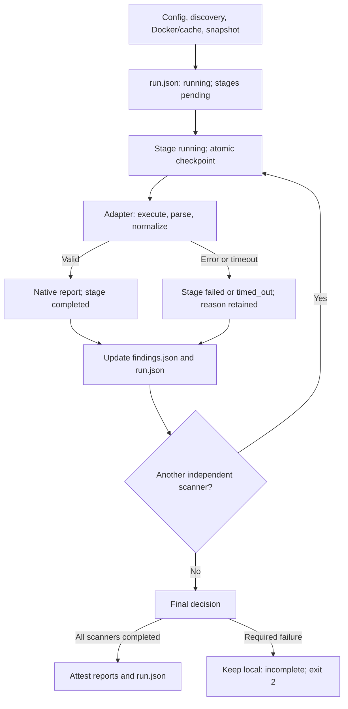

# Run and StageResult: incremental execution

The execution journal records stage progress, usable results, and the final
decision for `scan`, `test`, `build`, `image`, and `pipeline` commands. See
[application tests](APPLICATION_TESTS.md) and the [image workflow](IMAGE_WORKFLOW.md)
for their command-specific behavior.

## Three separate facts

| Information | Example | Meaning |
| --- | --- | --- |
| Stage state | `completed` | Usable scanner result, possibly containing findings |
| Native scanner exit | Gitleaks `10` | Interpreted and validated by the adapter |
| Flican decision/exit | `block`, `1` | Results violate the configured policy |

A scanner returning `0` with invalid JSON becomes `failed`. Its native code
remains `0`; the run finishes `failed` / `incomplete` / `2`.

## Current structures

`StageResult` in `src/flican/core/models.py` contains:

- `stage_id`, `tool`, `required`, `status`;
- `started_at`, `finished_at`, `duration_seconds`;
- observed native `exit_code`, or `null` without a process result;
- `findings_count`, `artifacts`, `coverage` for usable results;
- `profile_hash` and pinned image;
- `error` for failures or the reason a step did not run.

States are `pending`, `running`, `completed`, `failed`, `timed_out`, `skipped`,
`unsupported`, and `cancelled`. `unsupported` is reserved for future steps;
the current source scan does not emit it.

`Run` contains local identity, project, mode (`scan`, `test`, `build`, `image`,
`pipeline`), UTC dates, threshold, stages, artifacts, and final result.
`source_sha256` identifies snapshot paths, contents, and executable bits for
scan/test/build/pipeline. Older runs and standalone image runs may retain `null`;
image reports carry their own OCI digests. Run status is `running`, `completed`,
`failed`, or `cancelled`. Decision is initially `null`, then `allow`, `block`,
or `incomplete`.

Constructors and `from_dict()` validate known states, ordered UTC dates, finite
nonnegative durations, relative artifact paths, counter types, and decision/exit
consistency. Finished runs cannot leave stages `pending` or `running`.

## Execution flow



Scanners remain sequential: Gitleaks, Semgrep, Trivy, Checkov, sharing one snapshot.
Every selected scanner is currently required. Scanner failure lets later
independent scanners run; storage failure or cancellation stops remaining steps.

Native JSON becomes a valid artifact only after the entire stage parses and
normalizes successfully. One invalid finding prevents a partial stage from being
presented as success. Raw process output from a failed/timed-out process is not
exported in the journal.

## Files and outcome

```text
<project>/.flican/runs/<run-id>/
  run.json                     # Machine-readable journal, schema_version 1
  reports/
    gitleaks.json              # Only when this stage is usable
    ...
    findings.json              # Findings from usable stages
  manifest.json                # After successful completion of all required execution
```

`RunJournal` in `core/execution.py` writes a private temporary file and replaces
it atomically. Readers see the old or new checkpoint, never partially rewritten
JSON. Journal permissions are `0600`, directory permissions `0700`. Forced
termination can leave the last checkpoint `running`; this is neither an `allow`
decision nor an attestation.

`findings.json` retains `schema_version: 1`, findings, and coverage, with an
additional `execution` object. `gate.passed` is:

- `true` for `allow`, exit `0`;
- `false` for `block`, exit `1`;
- `null` while running or for `incomplete`, final exit `2`.

Consumers must require `gate.passed is True` before proceeding. `scanners` lists
configured selection; `execution.completed_scanners` identifies usable results.
Example after Semgrep fails:

```text
Run: failed, decision: incomplete, exit_code: 2
  gitleaks: completed, exit_code: 10, findings_count: 1
  semgrep:  failed,    exit_code: 2,  findings_count: null
  checkov:  completed, exit_code: 1,  findings_count: 1
```

Both valid findings remain available. On failure, the terminal prints the run
directory and `run.json` to stderr; complete execution prints to stdout.
Prerequisite errors before journal creation do not create a run.
[`--result-file`](SCAN_RESULT.md) provides an invocation-specific reference with
exact run/artifact paths, including failures before a run exists. It supplements,
rather than replaces, the journal and actual process exit status.

## DefectDojo and compatibility

New complete runs attest the `run.json` hash; the manifest completion timestamp
matches the journal. Modifying the journal after attestation causes import
rejection. Previously attested runs without a journal remain readable within
their original registered state.

A run with a failed/cancelled scanner remains **local and unsynchronizable** in
this increment. Attestation rejects incomplete journals. Selective import of
valid stages would require an explicit attestation/synchronization contract extension.

A `completed` Checkov stage may still have `partial` coverage because of
suppressions: execution state and coverage differ. Existing policy behavior
and `--close-old` safeguards continue to apply.

## Verification and limits

| File | Responsibility |
| --- | --- |
| `core/models.py` | States, contracts, validation |
| `core/execution.py` | Transitions and atomic checkpoints |
| `cli/main.py` | Adapter execution and incremental aggregation |
| `core/provenance.py` | Complete journal/report attestation |

Paths are relative to `src/flican/`. To inspect the calculator journal:

```bash
flican ci prepare tests/fixtures/projects/calculator
flican scan tests/fixtures/projects/calculator
```

The command prints the run directory containing `run.json`. The fixture includes
HIGH findings and normally yields policy block `1` with execution `completed`.

```bash
python -m unittest discover -s tests -p 'test_execution*.py' -v
python -m unittest discover -s tests -p 'test_scan_execution.py' -v
```

Tests cover invalid contracts, transitions, atomic replacement failure, results
saved before the next scanner, continued independent scans, timeout, Ctrl+C,
storage errors, invalid findings, attestation, and post-attestation journal edits.

## Limits

Local source/tests/build/image dependencies are implemented. Crash recovery,
complete stop-signal handling, inter-job provenance transport, and portable Git/CI
identity remain future work. See [ARCHITECTURE.md](ARCHITECTURE.md) for current scope.
