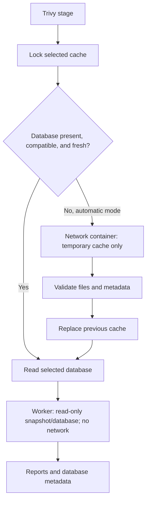

# Trivy vulnerability database

Automatic preparation, offline reuse, and pinning select the vulnerability
database independently of the pinned scanner image version.

## Default workflow

With Trivy enabled in `flican.yaml`:

```bash
flican scan ./my-api
```

Flican prepares the database when missing or its metadata is invalid. A valid
database is reused until `NextUpdate`, or during the hour after `DownloadedAt`,
matching the pinned Trivy client. After that interval, Flican fetches the published
database from that client's default repositories. It therefore does not download
a new copy for every scan, nor promise a registry query before every execution.

The default cache is `$XDG_CACHE_HOME/flican/trivy` when the base is nonempty and
absolute, otherwise `~/.cache/flican/trivy`. `--trivy-cache-dir` is an optional
override and can point to a directory that does not yet exist.
`flican ci prepare PROJECT` prepares scanner images and database; `flican db update`
only prepares/updates the database. They share selection and freshness checks.
`scan` does not implicitly pull scanner images: use `ci prepare` first.
An existing compatible cache can be reused explicitly with `--trivy-cache-dir`.

## Operation and failures



The update container sees only a temporary cache, with no source code, Docker
socket, or developer credentials. The snapshot worker stays offline with
`--skip-db-update`.

Flican operations on one cache serialize preparation and reads. Download or
validation failure preserves the previous database. Handled promotion failure
restores the previous directory; this is not machine-crash recovery.
A failed download causes **no silent stale-database fallback**: the Trivy stage
fails, other reports survive, and the run returns `2` (`incomplete`). The user
can explicitly choose offline mode.

## Offline mode

```bash
flican scan ./my-api --offline
```

No database download or refresh is attempted. A prepared compatible database is
required; it may be past its freshness deadline. Reports then record
`offline: true` and `fresh: false`. Missing/incompatible data yields `2`, without
claiming a complete scan.

## Pin a version by digest

Metadata `Version: 2` is a **schema version**, not a CVE update identifier.
Select an immutable database with the official `ghcr.io/aquasecurity/trivy-db`
OCI artifact digest:

```bash
# Replace with an actual OCI digest: sha256: followed by 64 hexadecimal characters.
flican scan ./my-api --trivy-db-digest 'sha256:REPLACE_WITH_REAL_DIGEST'
```

The placeholder is deliberately invalid. A mutable tag, schema number, or scanner
image digest does not select a fixed database version.

Flican downloads the requested official artifact into a separate cache:
`<cache>/pinned/<64 digest characters>/`. It does not replace automatic-mode data.
Once prepared, the pin remains associated with that digest after `NextUpdate`.
A local receipt binds the requested OCI digest to the database bytes' SHA-256;
those bytes are checked before reuse. Copying arbitrary data into the directory
is insufficient to claim a pin.

The option is shared by these commands:

```text
flican ci prepare PROJECT --trivy-db-digest sha256:...
flican db update --trivy-db-digest sha256:...
flican scan PROJECT --trivy-db-digest sha256:...
```

Combine a prepared digest with `--offline` to avoid downloads. Unavailable or
incompatible artifacts fail the stage; another digest is never substituted.
Custom private registries/mirrors for pinning are outside this increment.

## Evidence in reports

Successful source Trivy scans record the following under
`coverage.trivy.database` in `findings.json` and in the stage's `run.json` coverage:

- `auto`/`pinned` mode, offline selection, and requested digest when present;
- schema version, `UpdatedAt`, `NextUpdate`, and `DownloadedAt`;
- SHA-256 of the actual database bytes, freshness, and whether this execution downloaded it.

This information is included in attested artifacts and CI bundles. The requested
OCI digest and `trivy.db` file hash are different identifiers. Database files
and any associated credentials are not included in bundles.
Database timestamps do not change scanner profile identity on every refresh.
Adapter changes do change profile identity; an existing Dojo context may therefore
need a new compatible scope.

## Verification

```bash
python -m unittest discover -s tests -p test_trivy_db.py -v
python -m unittest discover -s tests -p test_cache.py -v
```

Tests cover downloads, freshness, offline mode, pin selection/integrity, cache
replacement and failed promotion, reader serialization, network separation,
and preservation of earlier scanner artifacts after database failure.

References: [Trivy 0.76.1 freshness logic](https://github.com/aquasecurity/trivy/blob/v0.76.1/pkg/db/db.go),
[database repository and OCI selection](https://github.com/aquasecurity/trivy/blob/v0.76.1/pkg/flag/db_flags.go).
